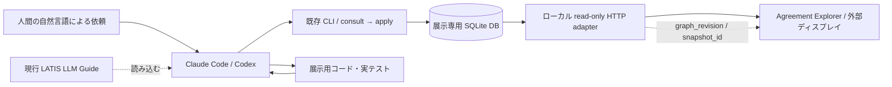

# LATIS / Agreement Explorer — 展示UI実装計画

**文書種別:** 実装担当LLM向けプラン（展示専用・規範仕様への変更案ではない）\
**版:** 2.0 / 2026-11-06（JST）\
**展示:** AIクリエイターズマーケット 2026 / 2026-11-07（土）\
**対象リポジトリ:** [ayumuwall/LATIS](https://github.com/ayumuwall/LATIS)\
**関連台本:** `LATIS_Graph_UI_Demo_Scenario_v2_2026-11-06.md`\
**ビジュアル指針:** `LATIS_Graph_UI_Visual_Design_2026-11-06.md`\
**参考資料:** `LATIS_Graph_Pulse_Design_2026-11-06.pdf`（コンセプト参照。完全再現はしない）

> **展示の約束:** 来場者が「仕様を一つ増やして」と話す。Claude CodeまたはCodexがいつもどおりLATISを使う。外部ディスプレイ上の**整列した階層ビュー**に確定済みの合意と理由が追加され、改訂時には**同じID・同じ行**の差分が現れる。

## 0. 最重要の実装判断

- **すでに動くCoreを作り直さない。** 現行リポジトリにはPython 3.12・SQLiteのCore、JSON CLIの日常9操作、実際のテスト・復旧スクリプトがある。Graph UIは現時点で未実装。リポジトリの記録上、M5の最終判定は進行中であり、本書は完成済みと宣言しない。
- **展示UIはread-only。** 書き込みは既存の`consult`→`apply`を使うLLMだけが行い、ブラウザーは確定済みSQLiteの状態だけを読む。相談中の候補を確定済み表示しない。
- **見た目は静謐に、変化は明確に、更新経路は単純に。** ローカルHTTP + 約750msのポーリング + ノードID/改訂IDの差分。WebSocket・SSE・3Dエンジンは必須にしない。
- **位置が飛ばないことが最優先。** Scope・合意・理由の**3列を整列した階層リスト**とし、追加・改訂時に既存行を全面再配置しない。差分と右側の説明で変化を読ませる。
- **フォールバックも本物の結果を使う。** LLM接続が不安定なら、過去に実際の`apply`から記録したデータを**「REPLAY」表示**で再生する。捏造したコミットをLIVEとして見せない。

### 0.1 参照する現行ソース（2026-11-05時点のGitHub mainを確認）

| 参照先 | 確認できたこと |
|---|---|
| [`AGENTS.md`](https://github.com/ayumuwall/LATIS/blob/main/AGENTS.md) | 日本語運用、Spec/API優先、LLM Guideの読み込み、Python 3.12、LLM利用時の隔離・モデル指定を規定。 |
| [`latis/cli.py`](https://github.com/ayumuwall/LATIS/blob/main/latis/cli.py) | `--db`と操作名を受けるJSON標準入出力CLIが存在。 |
| [`latis/storage.py`](https://github.com/ayumuwall/LATIS/blob/main/latis/storage.py) | 一貫したトランザクション内で`read(conn)`し、`state_at(data)`で現在状態を再構成できる。 |
| [`docs/IMPLEMENTATION.ja.md`](https://github.com/ayumuwall/LATIS/blob/main/docs/IMPLEMENTATION.ja.md) | P0/P1の実装、Python 3.12、`scripts/rehearse.py`、`scripts/reset_demo.py`による実演・復旧。 |
| [`docs/TASKS.ja.md`](https://github.com/ayumuwall/LATIS/blob/main/docs/TASKS.ja.md) | M5の最終確認が進行中。Graph UIはM6の検討候補として未実装。今回の展示作業は別タスク群として追加する。 |
| [`docs/v0.3.0/LATIS_Spec.md`](https://github.com/ayumuwall/LATIS/blob/main/docs/v0.3.0/LATIS_Spec.md)・[`LATIS_API.md`](https://github.com/ayumuwall/LATIS/blob/main/docs/v0.3.0/LATIS_API.md) | **実装の規範。** 本計画でCoreの意味・APIを独自に変更しない。 |

---

## 1. コンセプトと展示ビューの構成

**表示名:** `LATIS / Agreement Explorer`（日本語: 合意エクスプローラー）。前版の仮称`GRAPH PULSE`は正式UI名にしない。\
**コピー:** **AIが忘れても、合意は残る。**\
**視覚的な方向:** **モノトーン＋低彩度の紙色／System 7をモダンに再解釈／固定列の階層ブラウザ／少量のディザ・反転**。

添付PDF p.2〜4の「スコープ｜合意｜理由・問い・出所」、右Inspector、下部の変更ストリームを参考にする。ただし、図版の正確な再現や、画面全体の1bit装飾、巨大な縦書きスローガンを必須にしない。**最初の視線で階層が分かり、次の視線で変更が分かる**ことを優先する。

### 1.1 一覧を主役にする

- 中央は自由な蜘蛛の巣配置ではなく、**行が揃う階層リスト**。
- 左列`Scope`: `contains`の確定した関係を使ってツリーを示す。**継承・優先の関係を暗黙に作らない**。
- 中列`Agreement`: 該当Scopeへ明示的に所属する採択済み合意。ID・改訂・短い本文を表示。
- 右列`Context`: 記録済みのrationale、intent、question、artifactを短く表示。**理由は自動生成しない**。
- 画面右はInspector。現在の合意本文、理由、ID、Scope、版、来歴、差分を大きく読む。
- 画面下は`CHANGE LOG`（実在する確定済み変更）。補助メーターやコヒーレンス値は作らない。
- 複数Scopeへの所属は、同一IDを重複した合意として扱わず、表示参照で明示する。

### 1.2 配色・装飾・文字

| 対象 | 規則 |
|---|---|
| Paper | `#F2F1ED`または近い淡いグレー |
| Ink | `#111111`、補助は`#555555` |
| 区切り | 細い水平線・点・小さな直角コネクタ。太い網状の線を敷かない |
| 選択 | 白黒反転＋選択ラベル |
| 合意・Scope・理由の違い | □/◎/○/?等の**形と文字**。固定色分けはしない |
| 新規と改訂 | `NEW`/`REVISED`の明示ラベル、短い反転・本文差分 |
| オプションの単色シグナル | `#FF4A1C`を**実applyの確定直後のみ2〜3秒**。演出を切っても成立させる |
| 字体 | 日本語はシステム書体またはIBM Plex Sans JP、IDは等幅、DotGothic16は限定的な見出しにのみ使用。いずれもCDN必須にしない |

**重要:** `graph_revision`は`save-draft`でも進みうる。よって`revision`増加だけで「採択された」の合図を出してはならない。該当commitの`provenance.decision`等から**実際の`apply`か**を判定する。

### 1.3 展示向けレイアウトの概略

```text
┌─ LATIS / Agreement Explorer ───────────── demo-logs ─ [LIVE] rev 00040 ┐
│   Scope / スコープ   │  Agreement / 合意        │  Context / 根拠等    │ Inspector │
│ ▾ ログ管理           │ 個人情報のログ出力禁止   │ ─                  │ 本文      │
│   ├ 通常ログ         │ ◎ 保持期間 24時間       │ ─ 保存容量とコスト   │ 24時間    │
│   │                  │ ◎ UTCで記録 [NEW]      │ ─ 時差を防ぐ        │ 旧版/理由 │
│   ├ 監査ログ         │ ◎ 保持期間 90日         │ ─ 監査に備える      │ 履歴      │
│   └ 障害対応         │ ◎ trace_idで突合        │ · 振り返りメモ      │           │
├─────────────────────────────────────────────────────────┴───────────┤
│ CHANGE LOG  [00041 NEW] UTCで記録 / [00042 REVISED] 24 → 48時間       │
└─────────────────────────────────────────────────────────────────────┘
```

### 1.4 ビジュアルの優先順位

**P0:** Scope階層が見える／本文が読める／変更差分が分かる／再ロードで位置が跳ねない。\
**P1:** 短い白黒反転、控えめな1色アクセント、最小限のディザ・直交線描画。\
**作らない:** 常時脈動、ネオン、多色分類、巨大な自由配置ネットワーク、3D、見栄えだけの架空統計、複雑なズームパネル。

1920×1080を基準にするが、表示距離・実際の解像度を優先する。**合意タイトル18〜22px、Inspector本文20〜26px**を目安とし、狭い解像度ではContext列をInspectorへ移す。詳細はビジュアル指針を参照。

## 2. システム構成（既存Coreには手を入れない）



**重要:** `graph_revision`の増加は変更検出の入口にすぎない。該当commitが**採択済みの`apply`由来**と確認できた場合だけ、確定変更の演出を行う。`consult`や`save-draft`で得た候補は、採択済みとして描かない。

### 2.1 推奨ファイル配置（新規追加案）

```text
tools/graph_demo/
  server.py                 # Python 3.12標準ライブラリのみ。127.0.0.1に限定
  projection.py             # DBスナップショット → 画面専用JSON（read-only）
  static/
    index.html
    styles.css
    app.js
    # サードパーティのグラフ描画ライブラリは必須にしない
  README.ja.md              # 起動・操作・再現・障害時の短い説明
tests/test_graph_projection.py

docs/LATIS_GRAPH_DEMO_2026-11-07.md   # 本文書をリポジトリへ配置する候補
```

**推奨は素のHTML/CSS/JavaScriptの階層テーブル／ツリー**。Scopeの枝線と選択中の関係だけCSSや小さなSVGで描く。重い自動グラフレイアウトエンジンは不要。Vite、WebSocket、外部CDNなどは展示の必須条件にしない。Coreの`pyproject.toml`へUIの依存を追加しない。

### 2.2 read-onlyアダプターの実装

Python標準ライブラリの`http.server.ThreadingHTTPServer`と`sqlite3`を使い、**`127.0.0.1`でのみ待ち受ける**。localhostからの取得専用で、更新APIは作らない。キャッシュを無効にし、HTML・JS・CSSを同じサーバーから配信する。

- `GET /health`: 起動・DB疎通・現在の`database_id/graph_revision`を返す。
- `GET /api/graph`: 一つの整合した読取トランザクションから、現在のScope階層・合意行・文脈項目と更新識別子を返す。
- `GET /`: 静的UIを返す。
- **追加候補:** `GET /api/changes?after=<revision>`。時間がなければ作らず、クライアントで前回と今回のグラフを比較する。

現行の`latis/storage.py`には、`read(conn)`と`state_at(data)`がある。**展示専用アダプター**は、`sqlite3.connect(file:…?mode=ro, uri=True)`による読取専用接続で`PRAGMA query_only=ON`、`BEGIN`を実行し、同じトランザクション内で`storage.read(conn)`→`storage.state_at(data)`を呼ぶ方針とする。読み取りを終了したら速やかに`COMMIT`または`ROLLBACK`し、接続を閉じる。

- DBのパスはサーバー起動引数の**絶対パス**で固定。ブラウザーから任意パスを渡せない。`127.0.0.1`のみlistenし、書き込み用HTTPルートを設けない。
- 現行SQLiteテーブル・JSON構造に沿う**表示用投影**のみを行い、保存形式を変更しない。ScopeとAgreementの表示行は明示関係から組み立て、表示順は安定IDと定義済みのScope順で固定する。
- `nodes`と`relations`は現在の正本状態から、`lifecycle`、`confirmation`、`revision_id`、`provenance`への参照等を必要分だけ返す。
- 投影側でScopeの勝者、優先順位、意味的競合を**推論しない**。候補と確定済みを区別する。
- `meta.graph_revision`と`meta.snapshot_id`を必ず付ける。初回ロードはアニメーションせず、次回以降も**確定済みapplyの変更だけ**短く強調する。
- 展示規模は数十ノード。`storage.read()`による履歴読み込みの負担は実測するが、展示では新しい索引や正本DBのschema変更を行わない。
- 接続エラー時は**前回表示を保持**して「DISCONNECTED / 再接続中」を表示。空のグラフを返して消してはいけない。

#### 画面専用の応答例（**新しいCore APIではない**）

```json
{
  "meta": {
    "database_id": "...",
    "graph_revision": 8,
    "snapshot_id": "...",
    "view_mode": "accepted_and_context",
    "display_limit": 30
  },
  "nodes": [
    {"id": "ag_normal", "revision_id": "rev_latest", "kind": "agreement", "lifecycle": "accepted", "title": "通常ログは48時間保持する", "body": "..."},
    {"id": "scope_logs", "revision_id": "rev_scope", "kind": "scope", "lifecycle": "accepted", "title": "ログ"}
  ],
  "edges": [
    {"id": "rel_normal_scope", "from": "ag_normal", "to": "scope_logs", "relation_kind": "scoped_to", "confirmation": "confirmed", "lifecycle": "active"}
  ],
  "recent_changes": [
    {"graph_revision": 8, "target_type": "node", "target_id": "ag_normal", "change_type": "update"}
  ]
}
```

上のID・値は**模式例**である。実装はリポジトリの現在の保存構造から値を取得し、未存在のAPIやフィールドがあるように説明しない。`recent_changes`は実在の`commits`と`revisions`から導出する。**採択表示には、commitが`apply`由来かを来歴（`decision`の有無）および成功済み記録で確認する。** `save-draft`由来のcommitで`graph_revision`が増えても、確定シグナルを出さない。

### 2.3 差分検出と表示遷移

**クライアントは、ノードのstable ID・revision_id・Scope行キーを基準にする。**

1. 初回表示：正本を静的に描く。過去のcommitを新規イベントとして再演しない。
2. `database_id`や基準履歴が切り替わる：**RESET/別DBへ切替**と明記し、全体を静的更新。過去の差分をLIVEとして扱わない。
3. `graph_revision`が同じ：何も変更しない。
4. `graph_revision`が進む：前回から現在までの実commitの`change_refs`と`provenance_id`を調べる。`provenance.decision`のある**apply由来の変更**だけを、確定変更の演出対象にする。
5. 新規の採択済みagreement：該当Scope行へ`NEW`を追加。関係が保存されていればその相手のrationale等も表示。存在しない関係を作らない。
6. 同じIDで`revision_id`が変化：**同じ行で**反転。Inspectorへ旧版・新版の実文字列差分を出す。`24時間 → 48時間`はあくまで実データの結果として表示。
7. 新規関係：記録された`relation_kind`・`confirmation`に従い、実線/破線を区別して表示する。Scope所属と根拠リンクを混同しない。
8. 複数commitが間に進む：閲覧可能な実履歴で表示可能なものを示す。途中状態の取得に失敗したら最終版へ同期し「複数件更新」を表示、架空の中間値を作らない。
9. 接続失敗：最後の正しい画面を保持、`DISCONNECTED`。復旧時は最新へ静的同期し、欠けた演出をLIVEとして偽装しない。

**モーション:** NEWは行の出現（短い`steps()`）と文字で、REVISEDは同一行の白黒反転＋差分表示。単色アクセントは採択確定直後2〜3秒だけの任意要素。常時動く波形・円形リング・星屑・自動カメラ移動は作らない。`prefers-reduced-motion`で全演出停止可能。表示更新目標は実commit確定から2秒以内（展示規模・実測で判定）。


### 2.4 投影と表示規則

- **Scope tree:** `contains`のactive/confirmedからだけ作る。自動的な効力継承を導入しない。
- **Agreement list:** `scoped_to`のactive/confirmedから所属させる。未分類の合意は「未分類」グループへ明示して置ける。
- **Context:** `supports`、`depends_on`、`originates_from`等、実在する関係と型を表示する。表示位置は関係の意味・優先権を追加しない。
- **Lifecycle / confirmation:** 採択済み／草稿／candidate／retiredは形・ラベル・線種で分ける。候補をacceptedの一覧に紛れ込ませない。
- **Inspector:** ノードID、現在revision、title、全文、所属Scope、接続先、必要なら履歴・provenanceを返す。記録がなければ「未登録」。内容を補作しない。
- **複数Scope所属:** 同一stable IDの一件として扱い、見せ方だけ参照行・サブ表示にできる。カウントが二重にならないようにする。
- **表示件数:** 当日は合意10〜30程度。検索/Scope展開で絞り、全グラフを無差別に描かない。
- **パフォーマンス:** 展示規模では`storage.read()`による全読取りを許す。将来の20万件用索引の導入を今回の成功条件に混ぜない。


## 3. 今回作る機能と作らない機能

### P0 — 11/7の展示成功に必要

- [ ] **G-01** `127.0.0.1`のread-only HTTPから、同じSQLite読取トランザクションで投影を返す。
- [ ] **G-02** `contains`のScope階層、`scoped_to`の所属、実在するrationale/intent等を、固定列・行整列で描く。
- [ ] **G-03** 遠目でも「通常ログ24時間」「監査ログ90日」が区別でき、右Inspectorで全文と理由を読める。
- [ ] **G-04** 実際の`consult → apply`後、新規合意・理由（保存された場合のみ）が該当Scope行に現れる。
- [ ] **G-05** 同じ合意IDの改訂で行を重複させず、本文の前後差分を大きく表示する。
- [ ] **G-06** `save-draft`、`consult`、失敗した`apply`で**確定演出を出さない**。`graph_revision`増加だけでは判定しない。
- [ ] **G-07** `database_id/graph_revision`と`LIVE/REPLAY/RECORDED/DISCONNECTED`を正しく示し、DB切替・断線で表示を偽装しない。
- [ ] **G-08** Claude CodeまたはCodexの少なくとも一方がGuideを使って自然言語から実際に更新し、画面に反映する。
- [ ] **G-09** `rehearse.py`と`reset_demo.py`で、DB・コード・テストを一組として安全に復元できる。
- [ ] **G-10** 外部ディスプレイ全画面で日本語が読める。デモ本体はCDNもネットワークも不要。

### P1 — P0が成立した後

- [ ] **G-11** 白黒反転＋短い単色Signal（2〜3秒）、控えめなディザ表示。
- [ ] **G-12** 実在する確定commitのCHANGE LOGと、同一ID改訂の差分をクリックで参照。
- [ ] **G-13** 選択した合意から近傍の理由・出所へフォーカス。関係線は選択部分だけ描く。
- [ ] **G-14** 実commitだけを使うREPLAYの演出。未完成なら収録映像を`RECORDED`で提示。

### 今回は作らない

Coreの新しい権限管理、CSS的な自動継承・優先関係、DecisionRAG、ベクトル検索、20万件の性能保証、3D描画、自由配置ネットワーク、オールインワン編集UI、WebSocket、複数DB同期、未承認内容の即時採択。


## 4. 実装の順序と停止条件

### フェーズA：Graphを最初に表示する

1. `tools/graph_demo`を作成し、同一read snapshotから現在のノードと関係を取得する。
2. 最新のデモfixtureから作った**専用DB**を読み、ブラウザーで最初のグラフを描画する。
3. この時点では静的でよい。**3列に整列したScope・Agreement・Context、ラベル、右Inspector**を完成する。
4. 初期画面の階層と本文が読めない限り、装飾的な演出に着手しない。

**完了条件:** コード・DBを変更せず、初期の通常ログ24時間と監査ログ90日が別々の合意として読める。

### フェーズB：実際の保存と画面を結ぶ

1. CLIで実際の`consult`→`apply`を行い、`graph_revision`が増えることを確認。
2. UIを約750msで更新し、追加・改訂をIDと版の差分から検出する。
3. 同じノードの**行固定**、必要な関係表示、更新後の右パネルを通す。
4. `consult`のみ、不成功のapply、DB断線、リセットの各分岐を検査する。

**完了条件:** CLIでの正規の合意追加と24→48時間改訂を、**UIが正しく区別して表示**する。保存確定から表示までの目標は通常2秒以内（展示規模・ローカル端末で実測）。

### フェーズC：展示品質へ磨く

1. 必要なら**短い白黒反転、単色Signal、最小限の行更新**を追加。
2. 長い日本語を省略せず詳細欄へ表示。画面の拡大・縮小と選択を調整。
3. **モノトーン／明るい紙色UI**を外部ディスプレイ上でフルスクリーン確認する。
4. 停止・再起動・リセット後の復旧と、REPLAY／録画フォールバックを確保する。

**完了条件:** 初見でも「Scopeの階層」と「何が変わったか」を順に理解でき、未確定を採択済みと誤認させない。

### フェーズD：LLMを使った通し確認

1. `AGENTS.md`・`LATIS_LLM_Guide.md`を読み込む構成でClaude CodeまたはCodexを起動。
2. **LATISの名前を出さない自然言語の依頼**から、新規仕様を採択してUI更新まで確認。
3. 通常ログ保持時間を変更し、同じIDが改訂され、監査ログは維持されることを確認。
4. 可能なら新しいセッションで理由と履歴を検索し、再利用できることを確認。
5. 既存プロジェクトの安全指示に従う。Claudeの自動検証は`AGENTS.md`が定める`--safe-mode`・`--restricted`・必要なOS隔離を守り、許可範囲を勝手に広げない。

**完了条件:** 同じプロンプト手順が安定して再現できる。途中で失敗した場合に、コア仕様を削らずP1演出から諦める。

---

## 5. スケジュール（JST・展示までの優先順位）

| 期間 | 作業 | その時点で動いていてほしいもの |
|---|---|---|
| **11/6前半** | フェーズA＋Bを最優先 | CLIで`apply`すると外部画面のグラフが更新する |
| **11/6後半〜夜（機能凍結）** | フェーズC＋D、リハーサル、機材確認 | LIVEの通し、復旧、録画またはREPLAYを用意 |
| **11/6夜の機能凍結後** | 不具合修正・文字サイズ調整のみ | 新機能を増やさず確実に起動できる状態 |
| **11/7 8:15〜9:45** | 展示会場で設営・通し確認 | 外部画面、給電、Wi-Fi、CLI、表示、リセットを確認 |
| **11/7 10:00〜17:00** | 展示 | 繰り返せる2〜4分の体験 |

日程・ブース条件は、ユーザー提供の「AIクリエイターズマーケット2026出展マニュアル（2026年10月20日版）」に基づく。備品は幅1800×奥行450mmのテーブル、電源100V 1500W・1口。専用ネット回線はない。機材の接続条件は外部モニターの実機で確認する。

**開発の停止条件:** P0の実保存→UI表示が成立したら、P1演出の未完成を理由にコア動作を壊さない。11/6夜以降は依存ライブラリの大規模変更、保存形式の変更、M5の未完作業との無理な同時改修を避ける。

---

## 6. データセット・リセット・起動

### 6.1 再現性のある展示データを作る

既存の[`scripts/rehearse.py`](https://github.com/ayumuwall/LATIS/blob/main/scripts/rehearse.py)は、通常ログ24時間→48時間、監査ログ90日、実コード・テスト・証拠の履歴と初期/最終バックアップを生成する。`scripts/reset_demo.py`は、その成果から新しい専用作業ディレクトリへ**DB・コード・テスト・証拠を一組で**復元できる。

```sh
# リポジトリ直下。Python 3.12の仮想環境を使用すること。
source .venv/bin/activate
python --version  # 3.12.xを確認

# 初回、まだ存在しない場所へリハーサル成果を生成。
python scripts/rehearse.py --output /tmp/latis-graph-rehearsal

# 毎回新しい場所へbaselineを復元（destinationは存在していてはいけない）。
python scripts/reset_demo.py \
  --source /tmp/latis-graph-rehearsal \
  --destination /tmp/latis-graph-live-001 \
  --state baseline --format sqlite

export LATIS_DB=/tmp/latis-graph-live-001/demo.sqlite
./bin/latis --db "$LATIS_DB" meta <<<'{}'
```

- 実デモは`/tmp/latis-graph-live-001`内の**作業コピー**で行う。`examples/demo_project`や`/tmp/latis-graph-rehearsal`の基準ファイルは変更しない。
- 同じ展示を繰り返すときは、`-002`など**新規のdestination**へ復元し、LLMとビューアのDBパスを共に切り替える。
- もし書込みの途中でLLMやネットが止まったら、まずDBの現在revisionを確認。古い基準版の`apply`を無理に再使用しない。

### 6.2 UIサーバーの起動（**実装後の予定コマンド**）

```sh
python tools/graph_demo/server.py --db "$LATIS_DB" --host 127.0.0.1 --port 8765
# 外部ディスプレイのブラウザーで http://127.0.0.1:8765 を開き、全画面表示。
```

**注意:** この文書は実装計画であり、現時点で上記`tools/graph_demo/server.py`はまだ存在しない。新規作成してから実行する。ブラウザーを動かすために外部のCDNやWi-Fiが必要な構成にしない。

### 6.3 動作チェック（実装後）

```text
[ ] 画面ヘッダのdatabase_id / graph_revisionがCLI metaと一致する
[ ] 既存のノードは、750msごとの再取得で動かない
[ ] apply成功で更新。consultだけでは更新されない
[ ] 24→48時間で同じ合意IDと表示行が維持される
[ ] 監査ログ90日が変わらない
[ ] 再読込しても結果が同じ。更新演出は重複しない
[ ] DBを切り替えたら、RESETとして表示を更新する
[ ] DB接続を失っても誤った空グラフにしない
[ ] 別モニター解像度と文字サイズを実機確認した
[ ] ライブとREPLAYの表示が混ざらない
```

---

## 7. UI固有の受け入れ試験

| ID | 操作・条件 | 合格基準 |
|---|---|---|
| UI-01 | 初回にベースラインを開く | 正本の表示対象・関係・revisionが一致、初回アニメーションなし |
| UI-02 | `consult`だけ実行 | LIVEの正本グラフに差分アニメーションが起きない |
| UI-03 | 新しい合意と理由を`apply` | 該当Scopeに新しい合意行と実際の理由が表示される。推定した理由を勝手に捏造しない |
| UI-04 | 既存合意を同じIDで改訂 | ノードが重複しない。位置を維持し、前後差分を確認できる |
| UI-05 | `apply`失敗・変更取り消し | グラフが誤更新されない |
| UI-06 | 2回のcommitが近接する | 最終状態が一致し、抜けた更新があれば「複数件」として扱う |
| UI-07 | Viewer再接続／DBの一時ロック | 最後の正しい画面を保持し、復旧できる |
| UI-08 | 新規展示DBへ切替 | database_id変化を検出し、RESETを明示 |
| UI-09 | ブラウザーの操作 | 選択・Scope折り畳み・検索がDBを書き換えない |
| UI-10 | 1920×1080と小さめの画面 | 合意タイトル・更新後の内容・LIVE/REPLAYが判読できる |
| UI-11 | 実際のLLMによる保存 | ユーザーがLATISという名前を言わずに、過去合意の探索・採択・表示を実行できる |
| UI-12 | ネット切断 | UIはローカルで動く。LLM不可ならREPLAYへ切り替え、明示する |

**表示遅延の目標:** 小さな展示データについて、DBのcommit確定から画面の更新を通常2秒以内。計測点を**commit確定時刻と表示完了時刻**にし、LLMの推論時間とは別の値として記録する。現時点で達成済みとは記載しない。

---

## 8. 展示の安全性・品質上の注意

- DBへ書き込むのは既存CLI。GUIの操作は**閲覧、フォーカス、REPLAYの制御のみ**とする。
- ログやブラウザーへ秘密・個人データを流さず、すべて架空の展示用合意を使う。
- LLMが自然言語を誤解した場合は、Coreの照合と必要なユーザー確認へ戻る。見た目のために未合意の変更を採択しない。
- LIVE画面の内容はDB由来。過去の記録を使った演出では**REPLAY**、録画では**RECORDED**と表示する。
- 画面収録時にAPIキー、個人のアカウント、パス、開発用ログの秘密値を映さない。
- 自動カメラ移動は軽めにし、`prefers-reduced-motion`や手動停止を許す。フラッシュを繰り返さない。
- 既存CoreのテストとM5作業を壊さない。Graph Demoは展示用の独立モジュールとテストにする。

## 9. 最終的な「展示成功」の定義

**最低成功:** LLMが本物のCLIから合意を追加または改訂し、同じDBの実グラフが外部ディスプレイ上で自動更新される。内容と理由が読め、過去の合意を壊していないことが説明できる。

**理想成功:** 明快なScope階層、同じIDの改訂、短い反転と本文差分、理由への接続、別セッションでの引継ぎまで、途切れずに示せる。

**失敗時の最低保証:** 本物の過去のcommitのREPLAYまたは明示した録画から、同じ価値を説明できる。LIVEと誤認させず、Coreの現状を正確に伝える。
